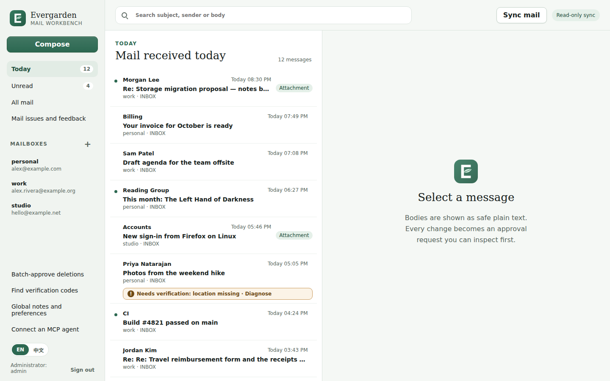
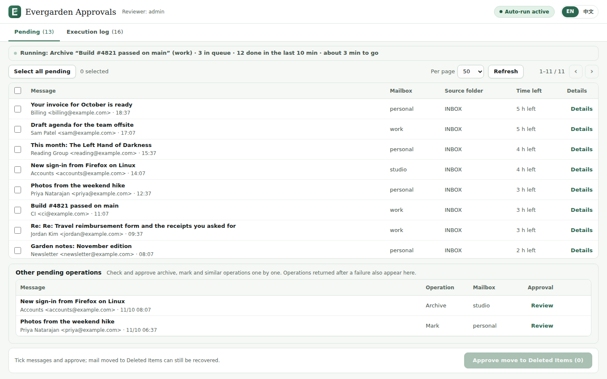
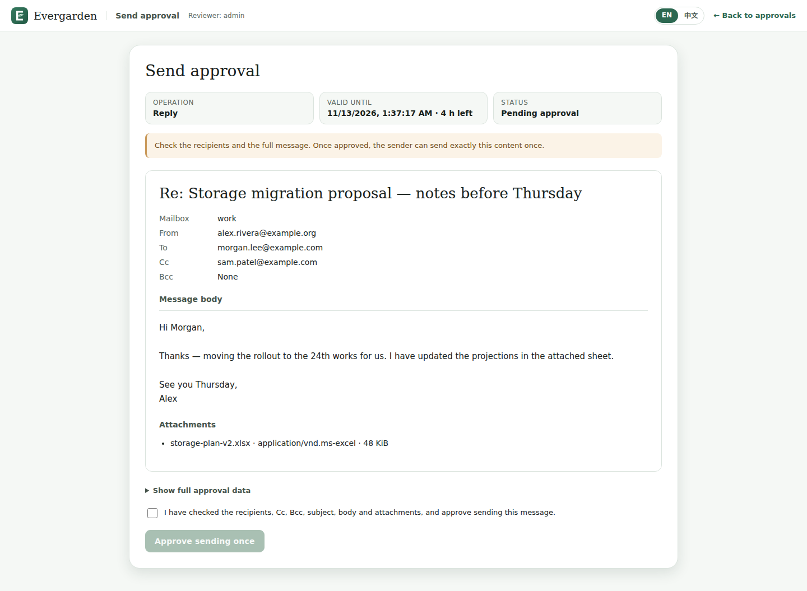

# Evergarden

**A self-hosted mail workbench and MCP server where AI agents read freely and
every change to your mailbox waits for your approval.**

[简体中文](README.zh-CN.md)

Evergarden keeps a local, searchable archive of your IMAP mailboxes and serves
it to AI agents such as Claude Code and Codex over MCP. Agents can read,
search and draft as much as they like. Every write at your mail provider
(send, move, archive, mark, Trash) becomes an approval request that you review
in a separate web UI before anything happens.

## Why

Letting an agent manage your inbox is useful until it sends the wrong reply or
files the wrong message. Evergarden draws the line at the provider: reading is
cheap and safe, so it is unrestricted; changing your mailbox is not, so each
change is a fixed, inspectable request that only you can approve. You can relax
that per kind of action (auto-approval), except for Trash.



| Approval queue | Send review |
|---|---|
|  |  |

## Features

- **Local mail archive.** Read-only, incremental IMAP sync of several
  mailboxes into SQLite, with full-text search, threads and attachments.
  Messages keep their identity when moved or renumbered.
- **MCP server** with 41 tools in scoped groups: metadata, read, attachments,
  drafts, sync, organize, send, delete (Trash), settings, verification codes,
  operations.
- **Approval workflow.** Agents prepare immutable drafts; you approve them in
  the web UI, singly or in batches, and can revoke an approval before it runs.
  Approved requests run in the background and every outcome is logged.
- **Careful execution.** The message is re-checked at the provider right before
  each change; unknown outcomes are verified read-only; mail is never sent
  twice; nothing is ever deleted permanently.
- **Mail workbench** in the browser: read, search, compose, reply, forward,
  organize, look up verification codes, keep notes for your agents.
- **Self-service MCP API keys** with per-key scopes and expiry, plus generated
  setup snippets for Claude Code, Codex and generic MCP clients.
- **Providers**: any IMAP/SMTP server with a password, Gmail (app password or
  your own Google OAuth client), iCloud, Outlook.com and Microsoft 365 (your
  own Microsoft Entra app).
- **English and Chinese interface**, light and dark, desktop and phone.
- **One-command setup** with Docker Compose; writes are off until you switch
  them on.
- Optional: in-stack scheduler or systemd timer, receive-only Thunderbird
  bridge, OAuth for MCP clients, SOPS-managed configuration, Microsoft MFA
  auto-login.

## Quickstart

```bash
git clone https://github.com/Chivier/evergarden-mail.git evergarden
cd evergarden
./deploy/setup                 # prints the administrator password once
docker compose up -d --build
# open http://127.0.0.1:8788 and sign in
```

Then add a mailbox, store its password, sync, create an MCP API key and connect
your agent. The full walkthrough, including enabling writes and approving a
first action, is in [docs/quickstart.md](docs/quickstart.md).

## Supported providers

| Provider | Sign-in | Notes |
|---|---|---|
| Any IMAP/SMTP server | password | Moves need IMAP MOVE, or UIDPLUS, or the copy fallback. |
| Gmail / Google Workspace | app password or OAuth (your own Google Cloud client) | |
| iCloud Mail | app-specific password | No IMAP MOVE: UIDPLUS move or copy fallback. |
| Outlook.com / Microsoft 365 | OAuth (your own Microsoft Entra app) | Authorization code or device code flow. |

Details: [docs/providers.md](docs/providers.md).

## Security model

- Agents get scope-limited, expiring, revocable tokens. They never see
  mailbox passwords, OAuth tokens or keys, and there is no approve,
  permanent-delete/expunge or raw-provider tool.
- Every provider write is an immutable draft bound to a hash. Only the human,
  signed in to the web UI, can approve it (or a per-kind auto-approval policy
  that never covers Trash). Approvals are used once.
- A single switch, off by default, decides whether this install may write to
  providers at all.
- Mail is shown as plain text; HTML and remote content are never loaded.
- Credentials are encrypted at rest; everything runs on your host, published
  only on `127.0.0.1` unless you add a reverse proxy.

The threat model, container isolation and known trade-offs are in
[docs/security.md](docs/security.md).

## Documentation

| | |
|---|---|
| [Quickstart](docs/quickstart.md) | Install, first mailbox, first agent, first approval |
| [User guide](docs/user-guide.md) | Workbench and approval pages |
| [Providers](docs/providers.md) | IMAP, Gmail, iCloud, Microsoft; mailbox fields |
| [MCP](docs/mcp.md) | Client setup, tools and scopes |
| [Configuration](docs/configuration.md) | Every setting |
| [Operations](docs/operations.md) | Backup, upgrade, scheduling, reverse proxy, troubleshooting |
| [Architecture](docs/architecture.md) | Components, data, approval lifecycle |
| [Security](docs/security.md) | Threat model and trade-offs |
| Advanced | [Thunderbird bridge](docs/advanced/thunderbird-bridge.md), [OAuth for MCP clients](docs/advanced/authelia-oauth.md), [SOPS](docs/advanced/sops.md), [MFA auto-login](docs/advanced/mfa-autologin.md) |

中文：[快速开始](docs/zh-CN/quickstart.md) · [使用手册](docs/zh-CN/user-guide.md)

## Project status

Early, single-maintainer, self-hosted software. There is no hosted service.
Expect rough edges and breaking changes between minor versions; read the
[changelog](CHANGELOG.md) before upgrading.

Contributions are welcome: see [CONTRIBUTING.md](CONTRIBUTING.md). Report
security issues privately as described in [SECURITY.md](SECURITY.md).

## License

[MIT](LICENSE)
