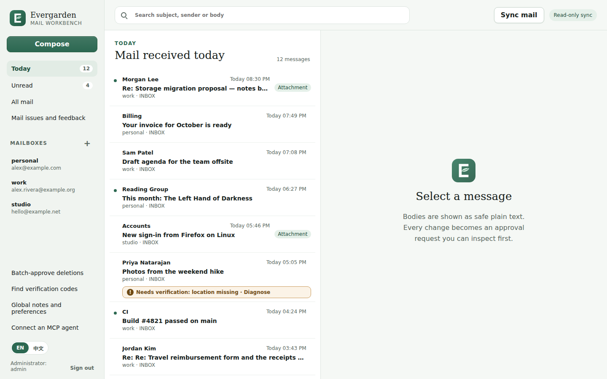
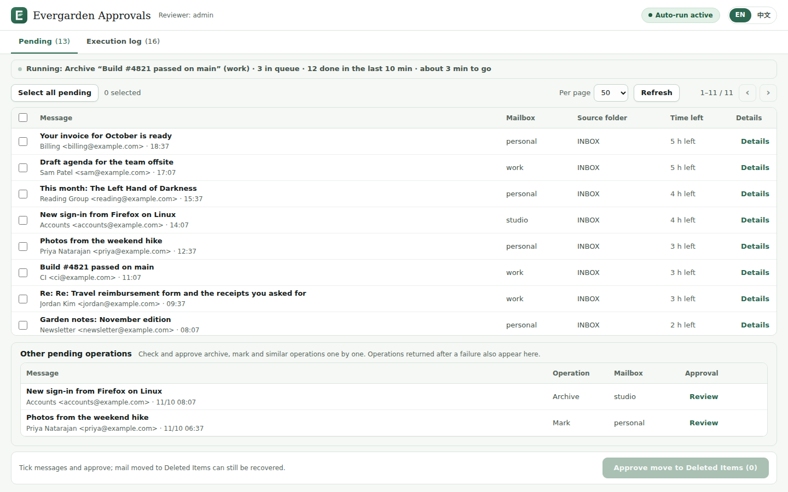
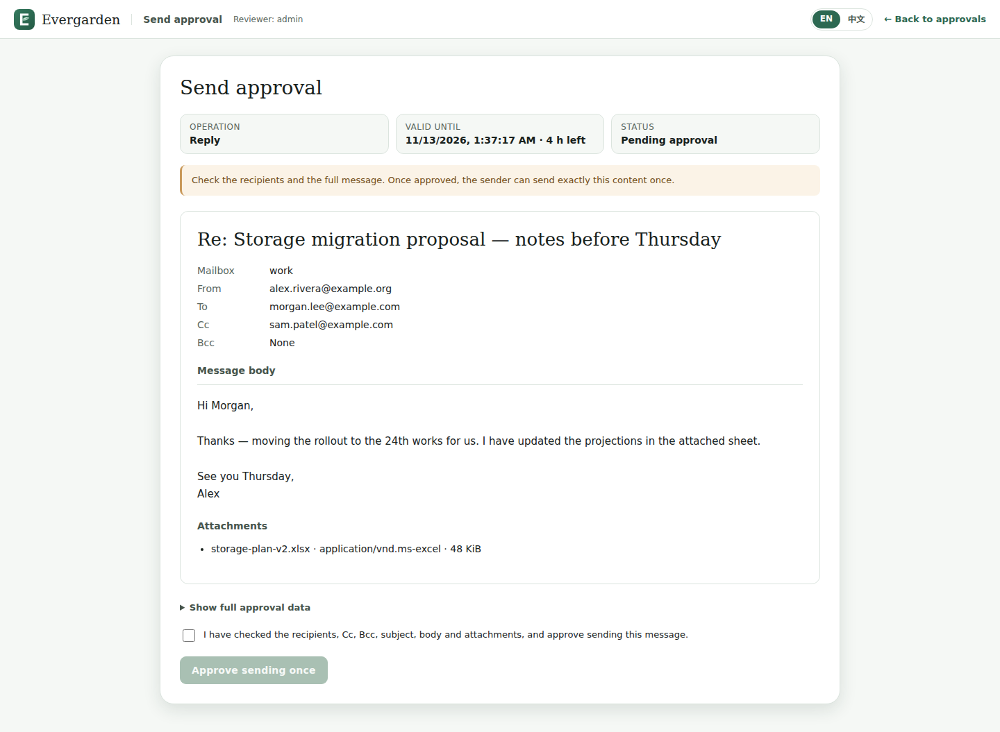

# Evergarden

**自托管的邮件工作台与 MCP 服务器：AI agent 可以自由读信，但每一次对邮箱的修改都要等你批准。**

[English](README.md)

Evergarden 把你的 IMAP 邮箱同步成本地可搜索的归档，并通过 MCP 提供给 Claude Code、
Codex 等 AI agent。agent 可以随意读信、搜索和起草；而对邮件服务商的每一次写操作
（发送、移动、归档、标记、移入废纸篓）都会变成一张审批单，你在独立的网页界面里
审核之后才会执行。

## 为什么

让 agent 打理收件箱很方便，直到它回错一封信或归错一封邮件。Evergarden 把界线划在
邮件服务商这一侧：读信便宜且安全，所以不加限制；修改邮箱不是，所以每次修改都是一份
固定、可检查、只有你能批准的请求。你可以按操作类型放宽（自动批准），但移入废纸篓
永远需要人工批准。



| 审批队列 | 发送审批 |
|---|---|
|  |  |

截图为英文界面；界面可在英文和简体中文之间切换。

## 功能

- **本地邮件归档**：对多个邮箱做只读、增量的 IMAP 同步，存入 SQLite，支持全文搜索、
  会话线程和附件。邮件被移动或文件夹重新编号后仍保持同一身份。
- **MCP 服务器**：41 个工具，按 scope 分组：元数据、读信、附件、草稿、同步、整理、
  发送、删除（废纸篓）、设置、验证码、运维。
- **审批流程**：agent 生成不可变草稿；你在网页上逐个或批量批准，并可在执行前撤销。
  批准后的请求在后台执行，每个结果都有记录。
- **谨慎执行**：每次修改前都会在服务商处重新核对邮件；结果不明时只读核对；
  邮件绝不会发送两次；从不永久删除。
- **网页邮件工作台**：读信、搜索、写信、回复、转发、整理、查找验证码、给 agent 写说明。
- **自助 MCP API key**：每把 key 单独设 scope 和有效期，并自动生成 Claude Code、
  Codex 和通用 MCP 客户端的配置片段。
- **支持的服务商**：任何使用密码的 IMAP/SMTP 服务器、Gmail（应用专用密码或你自己的
  Google OAuth 客户端）、iCloud、Outlook.com 和 Microsoft 365（你自己的 Microsoft Entra 应用）。
- **中英文界面**，浅色和深色模式，电脑和手机。
- **一条命令完成初始化**，用 Docker Compose 运行；在你打开开关之前不会写入邮箱。
- 可选：栈内调度器或 systemd 定时器、只收不发的 Thunderbird 桥接、MCP 客户端 OAuth、
  SOPS 管理配置、Microsoft MFA 自动登录。

## 快速开始

```bash
git clone https://github.com/Chivier/evergarden-mail.git evergarden
cd evergarden
./deploy/setup                 # 只打印一次管理员密码
docker compose up -d --build
# 打开 http://127.0.0.1:8788 并登录
```

之后添加邮箱、保存邮箱密码、同步、创建 MCP API key 并连接 agent。完整步骤（包括
开启写入和批准第一个操作）见 [docs/zh-CN/quickstart.md](docs/zh-CN/quickstart.md)。

## 支持的邮件服务商

| 服务商 | 登录方式 | 说明 |
|---|---|---|
| 任何 IMAP/SMTP 服务器 | 密码 | 移动需要 IMAP MOVE、UIDPLUS 或复制兜底。 |
| Gmail / Google Workspace | 应用专用密码，或 OAuth（你自己的 Google Cloud 客户端） | |
| iCloud 邮件 | App 专用密码 | 没有 IMAP MOVE：使用 UIDPLUS 移动或复制兜底。 |
| Outlook.com / Microsoft 365 | OAuth（你自己的 Microsoft Entra 应用） | 授权码或设备码流程。 |

详见 [docs/providers.md](docs/providers.md)（英文）。

## 安全模型

- agent 拿到的是有 scope 限制、会过期、可随时吊销的 token。它们看不到邮箱密码、
  OAuth token 或密钥，也没有批准、永久删除（expunge）或直接访问服务商的工具。
- 每次写操作都是绑定哈希的不可变草稿。只有登录网页的你能批准它（或按类型设置的
  自动批准策略，但永远不包括废纸篓）。每个批准只能使用一次。
- 一个默认关闭的开关决定这套部署是否允许写入邮件服务商。
- 邮件以纯文本显示，从不加载 HTML 和远程内容。
- 凭据加密存储；所有服务运行在你自己的主机上，除非你加反向代理，否则只监听
  `127.0.0.1`。

威胁模型、容器隔离和已知取舍见 [docs/security.md](docs/security.md)（英文）。

## 文档

中文：[快速开始](docs/zh-CN/quickstart.md) · [使用手册](docs/zh-CN/user-guide.md)

英文：[Providers](docs/providers.md) · [MCP](docs/mcp.md) ·
[Configuration](docs/configuration.md) · [Operations](docs/operations.md) ·
[Architecture](docs/architecture.md) · [Security](docs/security.md) ·
[Advanced](docs/advanced/thunderbird-bridge.md)

## 项目状态

早期、单人维护的自托管软件，没有托管服务。会有不完善之处，小版本之间也可能有
不兼容变更；升级前请阅读 [CHANGELOG](CHANGELOG.md)。

欢迎贡献，见 [CONTRIBUTING.md](CONTRIBUTING.md)。安全问题请按 [SECURITY.md](SECURITY.md)
私下报告。

## 许可证

[MIT](LICENSE)
