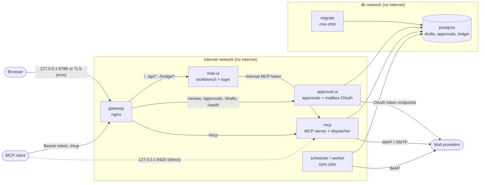

# Architecture

Evergarden is one Docker Compose stack on one host. It keeps a local archive of
your mail, serves it to agents over MCP, and turns every change an agent (or
you) wants to make at the mail provider into a draft that must be approved
before it runs.

## Topology

`mcp`, `approval-ui`, `worker`/`scheduler` and `gateway` are also on an
`egress` network: the first three to reach mail providers, the gateway because
Docker needs a non-internal network to publish its port. `mail-ui` is on the
internal network only. `postgres` is on a separate `db` network that only
`migrate`, `mcp`, `approval-ui` and `worker`/`scheduler` join, so `mail-ui` and
the gateway cannot open a connection to the database. The optional
`oauth-maintenance` and `mfa-autologin` services are described in
[security.md](security.md#containers).

| Service | Role |
|---|---|
| `gateway` | nginx. One origin for the web UI, approval pages and `/mcp`. Holds no secrets or data. Strips caller-supplied identity headers. |
| `mail-ui` | Workbench and administrator login. A backend-for-frontend: it calls MCP with its own token, which the browser never sees, and only allows a fixed list of tools. |
| `approval-ui` | Approval queue, send review, execution log, mailbox OAuth pages. |
| `mcp` | MCP server. Owns tools, drafts and execution; with `EVERGARDEN_APPROVAL_DISPATCH_ENABLED` it also runs approved drafts in the background. |
| `scheduler` / `worker` | Runs `config/jobs.yaml` jobs: hourly read-only sync and an OAuth readiness check. |
| `migrate` | Applies database migrations and records the writer settings, then exits. Runs on every `up`. |
| `postgres` | Drafts (encrypted), approvals, execution ledger, job leases, writer control. |

## Trust boundaries

- **Agents** reach only `/mcp`, with a bearer token that is checked for
  audience (`EVERGARDEN_MCP_RESOURCE`), expiry and scopes on every request.
  Tools are filtered by scope. There is no approve tool, no delete and no raw
  provider access.
- **The human** signs in to the web UI with the administrator password. The
  session cookie is signed, HttpOnly and SameSite=Strict; every state-changing
  request also needs a per-session CSRF token. Only the approval pages
  (`approval-ui`), behind that login, can issue a human approval.
- **Mail content is data.** Mail and notes are shown as plain text, never as
  HTML, and nothing in them can change scopes, allowlists, approvals or the
  write switch.
- **Providers** see only the operations an approval allows, after the target
  message's identity has been checked again.

Details and trade-offs are in [security.md](security.md).

## Data

| Data | Where | Notes |
|---|---|---|
| Provider mail | The provider | Only changed by approved actions. |
| Mail archive | `.local/data/archive/` (SQLite) | Messages, folder locations, search index. Files are mode 0600 in 0700 directories. Attachment bytes are additionally encrypted (AES-256-GCM). |
| Credentials | `.local/data/secrets/credentials.db` | Mailbox passwords, OAuth tokens, Google client, global notes and mailbox preferences, staged outgoing attachments. AES-256-GCM with the key in `.local/run/credential_store_key`; each record is bound to `EVERGARDEN_HOST_ID`. |
| Drafts, approvals, execution ledger | Postgres volume `<project>-postgres` | Draft payloads are encrypted. Provider results stored there are content-free metadata. |
| Mailbox inventory | `.local/run/mail-config/mail_accounts.json` | No passwords or tokens. |
| Runtime secrets | `.local/run/` | Generated by setup, mode 0600, each mounted only into the services that need it. |
| Administrator login | `.local/run/admin_credentials.json`, `admin_session_key` | scrypt hash of the password; HMAC key for sessions. |
| Reports | `.local/data/reports/` | Job results and failure reports; no mail content. |

## Mail sync

Sync is read-only. It selects each configured folder read-only, fetches new
messages with `BODY.PEEK[]` (which does not set the Seen flag), and records
every `(folder, UID, UIDVALIDITY)` location of each message, so a message keeps
one identity when it is moved or when the server renumbers a folder. Each run
also takes a UID and flag snapshot of every folder: locations that disappeared
are marked inactive, flags are refreshed, and mail moved by another client is
found in its new folder. A changed UIDVALIDITY resets only that folder; a
missing one fails safe. One failing mailbox or folder does not stop the others,
and a later run continues where a failed one stopped.

The Sent folder is not synced; `list_sent_metadata` reads its headers live.
A message whose location is missing stays in the archive and is listed under
**Mail issues and feedback**; a missing location never means the message was
deleted.

## Writer fence

A host performs provider writes only when all of these hold:

1. `EVERGARDEN_SIDE_EFFECTS_ENABLED=true` (the write switch).
2. `EVERGARDEN_ACTIVE_WRITER` is unset or equals `EVERGARDEN_HOST_ID`.
3. The execution holds a database lease whose host and `EVERGARDEN_WRITER_EPOCH`
   match this process.
4. For Trash: `EVERGARDEN_TRASH_ACTIONS_ENABLED=true` as well.

The `migrate` service records host, writer, epoch and the write switch in a
database row on every `up`. Raising the epoch fences out any older process
still running with the previous value. The fence is checked before an
approval is consumed, so a closed fence does not use up an approval. Permanent
delete and expunge are not effects the fence can allow at all.

Setting `EVERGARDEN_ACTIVE_WRITER=none` forbids writes from every host, for
example while you move an install to a new machine.

## Approval lifecycle

The code is in `evergarden/approvals/` (`service.py`, `errors.py`,
`dispatcher.py`).

### Draft

A `prepare_*` or `preview_*` tool builds the exact operation on the server:
account, From, recipients, body and attachment hashes for a send; account,
source folder, UID, UIDVALIDITY, Message-ID, content hash and destination for a
move or mark. It stores this payload encrypted with its SHA-256 hash. The draft
can be approved for `EVERGARDEN_APPROVAL_DRAFT_LIFETIME_HOURS` (default 6
hours).

For one message there is one pending draft per kind: asking again for the same
change returns the waiting draft, a different change replaces it. When an
archive, move or Trash of a message is confirmed, older pending drafts for that
message are retired, because their source location no longer exists.

### Approval

Each draft gets at most one approval, bound to its payload hash.

- **Human approval**: issued on the approval pages by the signed-in
  administrator. It is durable: it never expires and is either executed or
  revoked.
- **Policy approval**: issued at preparation time when the draft's kind is
  listed in `EVERGARDEN_AUTO_APPROVE` (`send`, `archive`, `move`, `mark`). It
  expires with the draft and is executed by the client that prepared it. Trash
  can never be auto-approved; the setting refuses it at startup.

A human approval that has not started executing (queued, waiting to retry, or
waiting for an earlier operation on the same message) can be revoked. Started
or finished executions are history and cannot be revoked.

### Execution

Executing an approval:

1. recomputes the payload hash and rejects any change;
2. checks the writer fence;
3. atomically claims the approval and creates a ledger row (`ATTEMPTING`) with
   a deterministic idempotency key, so two workers can never both run it;
4. re-reads the message at the provider and checks its identity (UIDVALIDITY,
   Message-ID, content hash) before changing anything;
5. performs the operation and records the outcome.

Who executes: with `EVERGARDEN_APPROVAL_DISPATCH_ENABLED=true`, the dispatcher
in the `mcp` service runs every human approval of an enabled kind in the
background, up to `EVERGARDEN_APPROVAL_DISPATCH_PARALLEL` mailboxes at a time
and in approval order within a mailbox. Without it, the client that prepared
the draft runs it with the `*_approved` tool. Policy approvals are always run by
the client.

Every attempt ends in one of three outcomes:

| Outcome | Ledger state | What happens next |
|---|---|---|
| Applied | `CONFIRMED` | Done. A send whose Sent copy could not be verified yet is re-checked read-only later; it is never sent again. |
| Not applied, before any change was attempted (connection, sign-in, token refresh) | `RETRYABLE` | The approval stays valid. The dispatcher retries after 1, 2, 3, 4, then every 5 minutes, until it succeeds or you revoke it. |
| Not applied, rejected by the provider | `FAILED` | Final. Prepare a new draft if you still want the change. |
| Unknown (for example the connection dropped after the command was sent) | `UNKNOWN` | Reconciled read-only, see below. |

### Unknown outcomes and replay

An unknown outcome is first checked read-only at the provider: is the message
at the destination and gone from the source, is the flag set, is the sent
message in the Sent folder under its Message-ID? The dispatcher sweeps
interrupted executions every minute and retries each unknown one every 10
minutes.

- Proven applied: `CONFIRMED`.
- Source and destination both lack the message: `FAILED` (the message is gone).
- Proven not applied: a **replay-safe** operation is issued again if the
  dispatcher allows that kind and the writer fence is open; otherwise
  (a send, a copy-first move, a closed fence or a kind that is not enabled)
  the row ends as `FAILED`.
- Still unprovable: a replay-safe operation is issued again; anything else
  stays `UNKNOWN` until it is proven either way or reaches the 24-hour cut-off
  below.
- Still unprovable 24 hours after the attempt: `FAILED` with
  `OutcomeUnverified`. It is not repeated and no longer blocks the message.

Replay-safe operations are marks and moves, archives and Trash that use native
IMAP MOVE: repeating them cannot do anything twice. A send is never replayed,
so mail is never sent twice. Moves that copy first (the UIDPLUS move and the
copy fallback) are never replayed either, because a second copy could
duplicate the message. A partial SMTP result (some recipients refused) is never
replayed and ends as `FAILED` after 24 hours. Replays honour the writer fence
and the enabled kinds: with Trash switched off, a Trash row is still reconciled
but never re-issued.

While an operation on a message is unresolved, newer approvals for the same
message wait ("Waiting for an earlier operation on the same message"); other
messages are not held up.

### Views in the UI

The approval pages group the detailed states into four phases:

| Phase | Contains |
|---|---|
| Pending | Drafts waiting for approval. |
| Running | Approved and queued, waiting for an earlier operation, retrying, running, verifying an unknown result, auto-approved and waiting for the client. |
| Succeeded | Confirmed by the provider or by read-only verification. |
| Failed | Rejected, message gone, proven not applied, unverifiable after 24 hours, revoked, or an auto-approval the client never ran. |

## Send guarantees

- The Message-ID and Date are fixed when the draft is prepared, so a retry or
  verification refers to the same message.
- Bcc recipients are only in the SMTP envelope, never in the message headers.
- Before sending, Sent is searched for the Message-ID; an existing copy means
  the message was already sent and it is not sent again.
- After the provider accepts all recipients, Evergarden checks Sent. If the
  provider did not save a copy and its absence is certain, Evergarden appends
  the exact approved message once. A timeout here is resolved by reading only.
- From must be one of the mailbox's `send_from_addresses`.

## Permanent exclusions

Permanent delete, emptying Trash, plain `EXPUNGE`, changes to Junk or Spam,
moves between mailboxes, creating folders, raw provider commands and
self-approval by an agent are not implemented. Mailbox OAuth sign-in happens
only on the human web pages, never through MCP.

## Code map

| Area | Modules |
|---|---|
| Settings | `evergarden/config.py` |
| Auth: MCP tokens, administrator login, credential store, provider OAuth | `evergarden/auth/` |
| Account rules (receive-only, UIDPLUS, allowed actions) | `evergarden/mail/policy.py`, `evergarden/mail/models.py` |
| Sync and archive | `evergarden/mail/sync.py`, `evergarden/archive/` |
| Provider connections | `evergarden/mail/imap_connector.py`, `evergarden/mail/smtp_connector.py` |
| Executing writes | `evergarden/mail/actions.py` |
| Approvals | `evergarden/approvals/` |
| Writer fence | `evergarden/automations/fence.py` |
| MCP tools | `evergarden/mcp/tool_definitions.py` (schemas), `evergarden/mcp/tools.py`, `evergarden/auth/policy.py` (scopes) |
| Applications | `apps/mcp`, `apps/mail_ui`, `apps/approval_ui`, `apps/worker`, `apps/mfa_autologin` |
| Database migrations | `migrations/` (append-only) |

Rules the code keeps, for contributors:

- What a mailbox may do is decided in `evergarden/mail/policy.py` only; other
  code passes those decisions through. A Thunderbird bridge mailbox stays
  receive-only, enforced both at the MCP tool gate and in `ApprovalService`.
- MCP tools are dispatched by table. `WRITE_PREPARE_KINDS`,
  `APPROVED_EXECUTION_KINDS` and the read handlers must together cover
  `TOOL_DEFINITIONS`, and every tool has exactly one entry in `TOOL_SCOPES`;
  `tests/test_tool_registry.py` checks this.
- Provider quirks live in the connectors; outcome classification (not
  attempted, rejected, unknown) lives in `mail/actions.py`.
- An archived message's identity is `(stable_id, account)`, derived from the
  account and Message-ID, so the Thunderbird bridge and native sync of the
  same message produce one record.
- Repositories return raw rows; statuses, phases and counts are computed once
  in `ApprovalService`.
