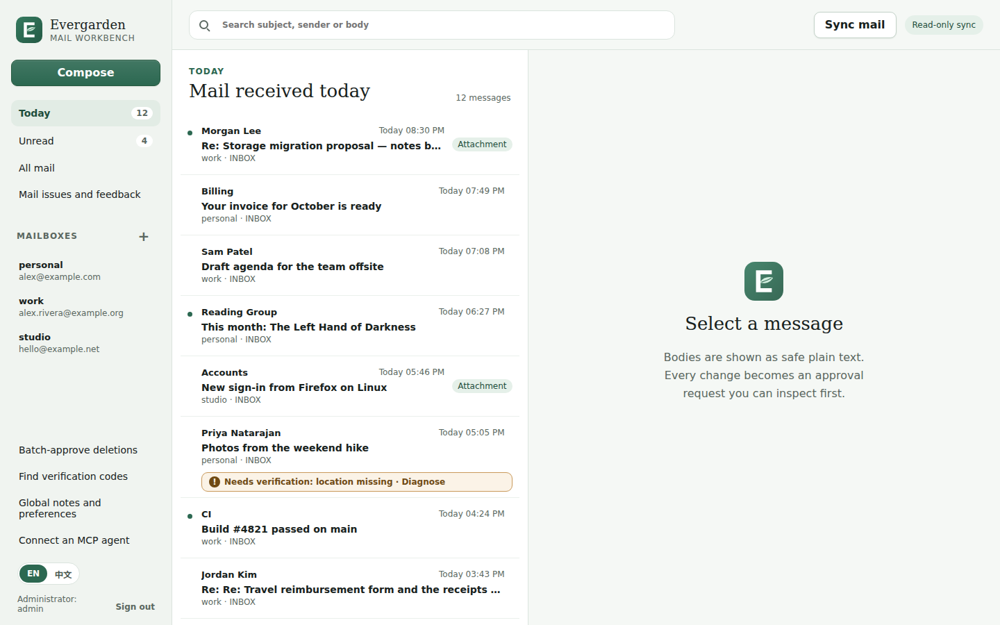
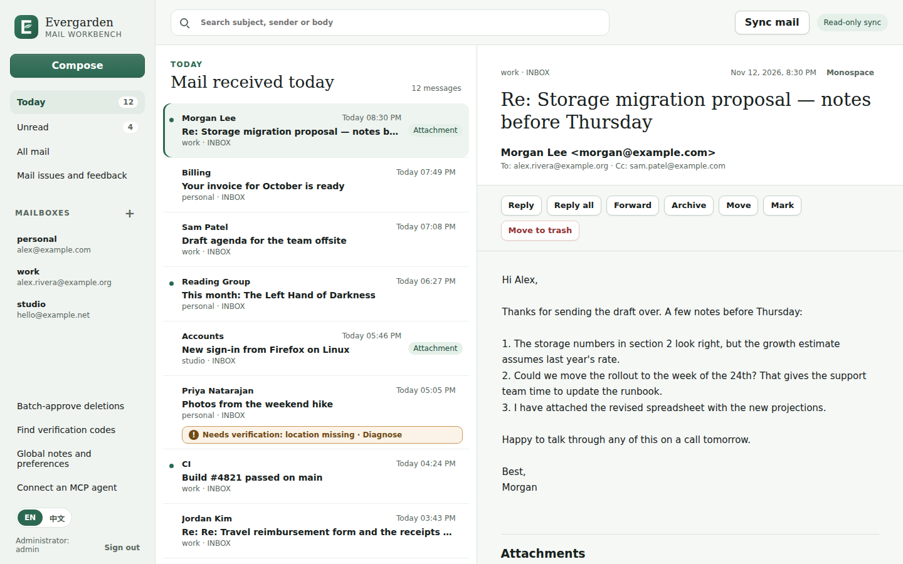
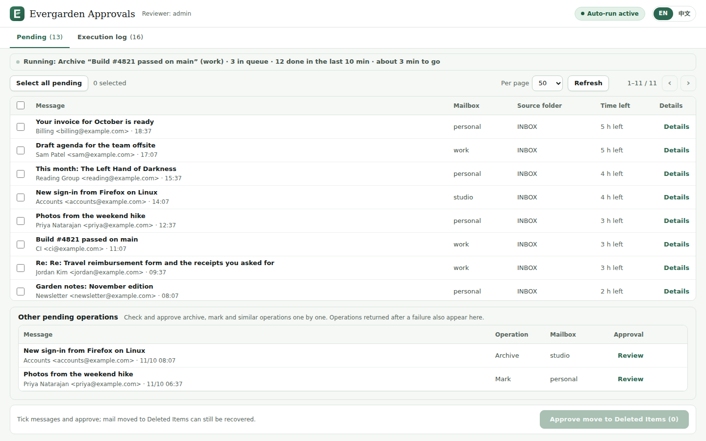
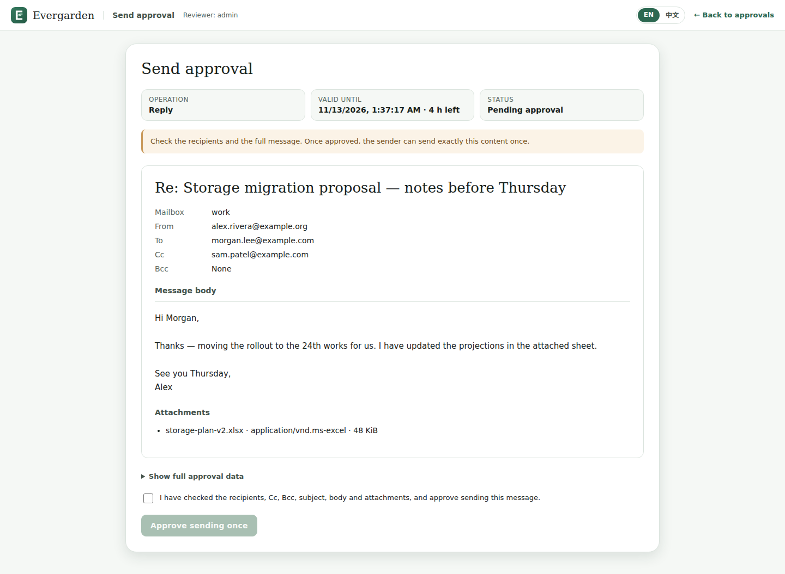
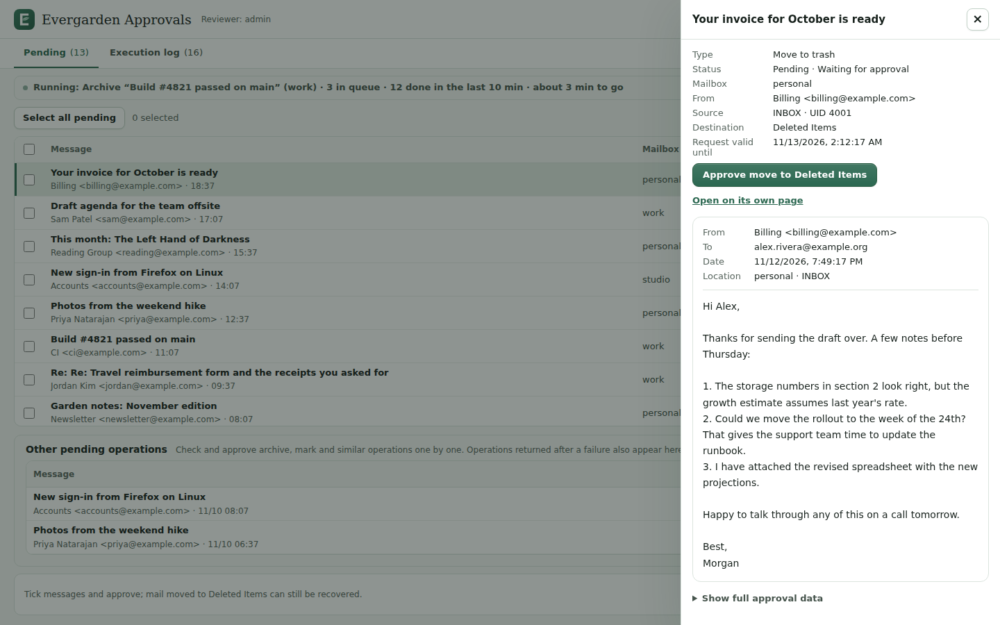
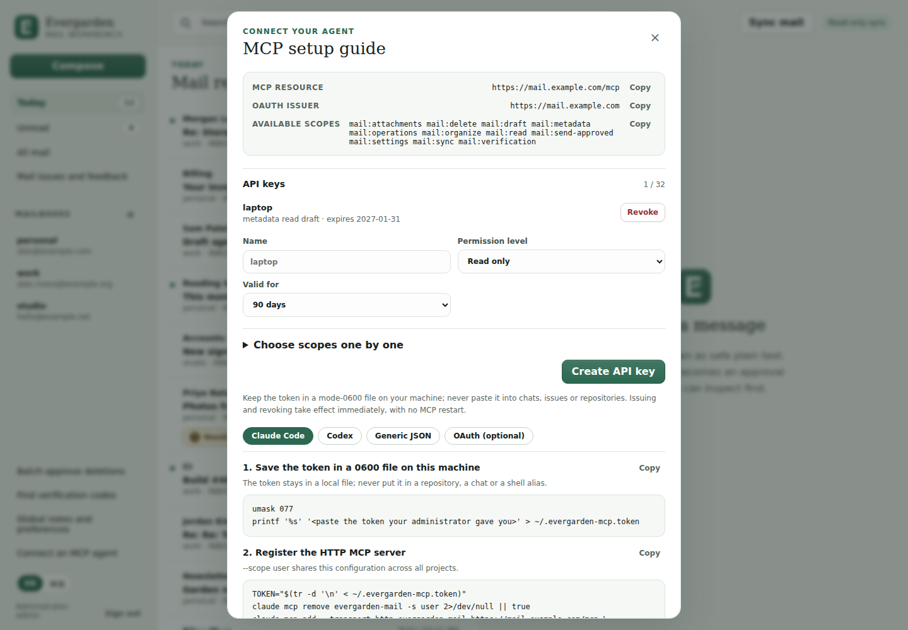
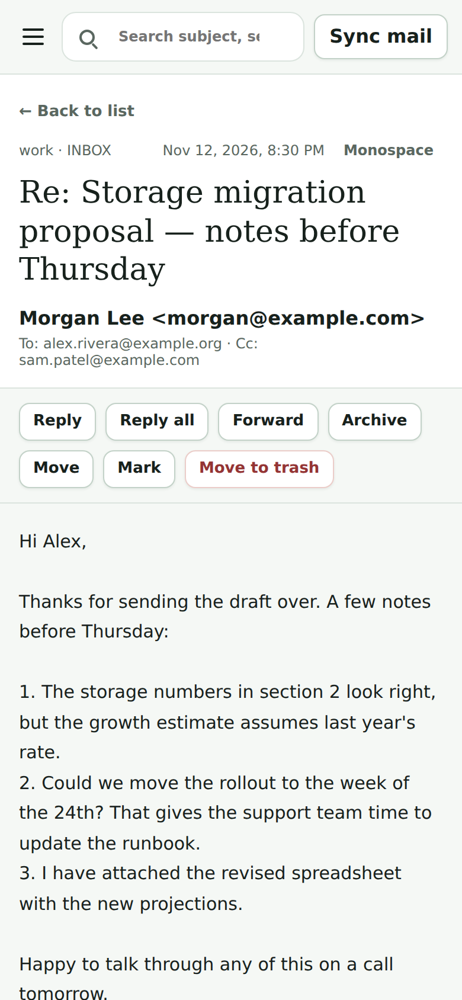
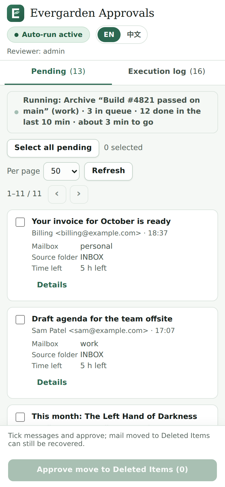
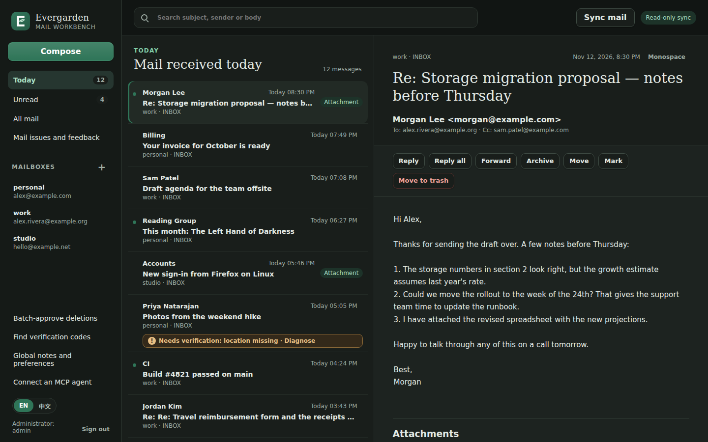

# User guide

Evergarden has two web surfaces on the same origin, behind one sign-in:

- the **mail workbench** (`/`), where you read, search and prepare changes, and
- the **approval pages** (`/review`), where you approve or revoke them and see
  what ran.

Labels below are quoted from the English interface. The Chinese interface is
described in [zh-CN/user-guide.md](zh-CN/user-guide.md).

## Signing in and language

Sign in with the administrator account that setup created. A session lasts 7
days by default (`EVERGARDEN_ADMIN_SESSION_TTL_SECONDS`, at most 30 days).
**Sign out** is at the bottom of the sidebar. It signs you out on **every**
browser and device at once, not only the current one: the server records the
sign-out and rejects all earlier sessions.

After 15 failed sign-ins from one address within 15 minutes (the defaults),
further attempts from that address get "Too many attempts. Try again later."
until the window passes. If several sign-ins arrive at the same moment, one
may be asked to retry after a second.

The **EN / 中文** switch (on the sign-in page, at the bottom of the workbench
sidebar and in the approval pages' header) changes the language. The choice
is stored in the browser; without one, the browser's language decides.

## The workbench

- **Today**, **Unread** and **All mail** list archived mail across all
  mailboxes; the mailbox names under **Mailboxes** filter to one mailbox.
- The search box searches subject, sender and body of the archive.
- **Sync mail** runs a read-only sync now. It does not change the Seen state
  at the provider. The hourly scheduled sync does the same in the background.
- Selecting a message opens it on the right. Bodies are always shown as plain
  text; HTML and remote images are never loaded. **Monospace** switches the
  font. Attachments have a **Download** button and are never opened for you.
- A message marked "Needs verification" has no confirmed location in the
  latest provider snapshot; see [Mail issues](#mail-issues-and-feedback).

## Preparing changes

Every change to your mailbox is first an approval request. The buttons on an
open message are **Reply**, **Reply all**, **Forward**, **Archive**, **Move**,
**Mark** and **Move to trash**; **Compose** in the sidebar starts a new message.

1. **Compose / Reply / Forward**: pick the **From mailbox** (and visible From
   address), fill in the recipients, subject and message, add attachments (at
   most 5 MiB each), and click **Create approval request**. Nothing is sent.
2. **Archive** moves to the mailbox's archive folder. **Move** offers only the
   mailbox's allowed destinations. **Mark** offers **Mark as read**, **Mark as
   unread**, **Flag** and **Remove flag**. **Move to trash** asks for
   confirmation and prepares a move to the configured Trash folder; nothing is
   ever deleted permanently.
3. A dialog, "Check the immutable operation", shows the exact request. Click
   **Open the approval page** to approve it in a new tab.

What happens after approval depends on the server setting:

- With background execution on (`EVERGARDEN_APPROVAL_DISPATCH_ENABLED=true`),
  the server runs the approved request by itself. **Check approval status**
  shows the result.
- Otherwise, come back to the dialog, click **Check approval status**, then
  **Run approved operation**.

Requests prepared by an agent appear on the approval pages in the same way.

## The approval pages

The header shows the reviewer and the state of background execution: **Auto-run
active**, **Auto-run stopped**, or **Client runs approvals** when background
execution is off. Below the tabs, an activity line names the operation being
run, the queue length and an estimate of the remaining time.

### Pending

The **Pending** tab lists requests waiting for you.

- The main table lists pending **Move to trash** requests with message,
  mailbox, source folder and **Time left** to review them.
- **Other pending operations** lists archives, moves, marks and sends. Click
  **Review** to open one.
- **Details** opens a drawer with the full message and, under **Show full
  approval data**, the exact request. From the drawer you can approve
  archives, moves and marks directly (**Approve Archive**, **Approve Mark**,
  ...).

A request can be approved until its review window ends (6 hours by default,
`EVERGARDEN_APPROVAL_DRAFT_LIFETIME_HOURS`). After that it expires and the
agent or you must prepare it again. An approval itself does not expire: once
you approve, the request runs or waits until you revoke it.

### Batch approval of deletions

Open **Batch-approve deletions** in the workbench sidebar, or the **Pending**
tab. Tick messages one by one, use the header checkbox (**Select this page**),
or **Select all pending** to select every pending deletion across pages. Then
click **Approve move to Deleted Items (n)**. Each selected request gets its own
approval bound to its own content; requests that expired or were approved
elsewhere in the meantime are reported individually, and the rest still go
through. Large selections are submitted in parts, with progress shown on the
button. Mail moved to Trash can still be recovered from the Trash folder.

### Approving a send

Outgoing mail has its own page (`/review/send`). It shows the mailbox, From,
To, Cc, Bcc, subject, the body exactly as it will be sent, and the
attachments. Tick "I have checked the recipients, Cc, Bcc, subject, body and
attachments, and approve sending this message." and click **Approve sending
once**. The approval covers exactly this content, once.

### Execution log

The **Execution log** tab lists every request with its type, who approved it
(**Human** or **Auto**), status and time. It refreshes every 5 seconds. The
filter chips are **All**, **Pending**, **Running**, **Succeeded** and
**Failed**:

| Phase | Includes |
|---|---|
| Pending | Waiting for your approval. |
| Running | Approved and queued; waiting for an earlier operation on the same message; mailbox temporarily unavailable, retrying automatically; running; verifying the result; auto-approved and waiting for the client. |
| Succeeded | Confirmed by the provider or by a read-only check. |
| Failed | Rejected by the provider; message no longer in its source folder; verified as not applied; result could not be confirmed within 24 hours; approval revoked; auto-approval the client never ran. |

The small text under a status gives the reason. Failures are final; to try
again, prepare a new request. "Verifying the result" means the connection broke
after the command was sent: Evergarden checks the mailbox read-only and does
not repeat a send. You do not need to do anything. See
[architecture.md](architecture.md#approval-lifecycle) for the full rules.

### Revoking an approval

An approval that has not started running (queued, retrying, or waiting for an
earlier operation on the same message) can be revoked: click **Revoke** on its
row in the execution log, or **Revoke approval** on its own page, and confirm. The server will not run it. Running or finished items cannot be revoked.

## Mail issues and feedback

**Mail issues and feedback** lists messages whose location could not be
confirmed in the latest provider snapshot, with the reason (for example
"location missing" or "UIDVALIDITY changed"). A missing location never means
the message was archived or deleted. **View / give feedback** shows read-only
diagnostics and lets you record a decision. Recording a decision never
changes mail; once a message is actionable again, prepare a fresh request.

## Other tools

- **Find verification codes**: reads 4-8 digit codes from the last 10 to 60
  minutes of mail that clearly mention a sign-in or verification. Optional
  mailbox and sender domain filters. You copy the code; Evergarden never fills
  it in or follows links.
- **Global notes and preferences**: free-text notes for your agents about how
  to handle mail, plus a description and preferences per mailbox. Stored
  encrypted on your host. They are guidance only and cannot override
  permissions or approvals. Never put passwords or secrets there.
- **Connect an MCP agent**: create and revoke API keys and copy client setup
  snippets. See [mcp.md](mcp.md).
- **Manage mailboxes** (the **+** next to **Mailboxes**): add a mailbox,
  disable or enable one, and open its OAuth connection page. See
  [providers.md](providers.md).
- **Company mail notifications** appears only when the optional
  [Thunderbird bridge](advanced/thunderbird-bridge.md) is configured.

## Phones and small screens

Both surfaces adapt to narrow screens: the sidebar becomes a menu (**Open
menu**), a message opens full screen with **← Back to list**, and approval
tables become cards.

| Workbench | Approvals |
|---|---|
|  |  |

The interface also follows the system's dark mode.

