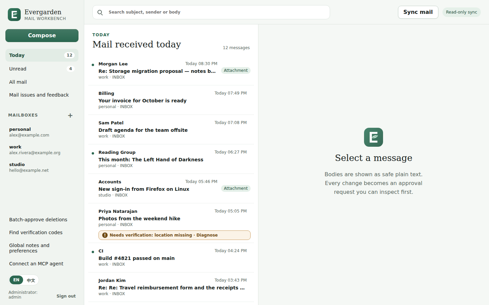
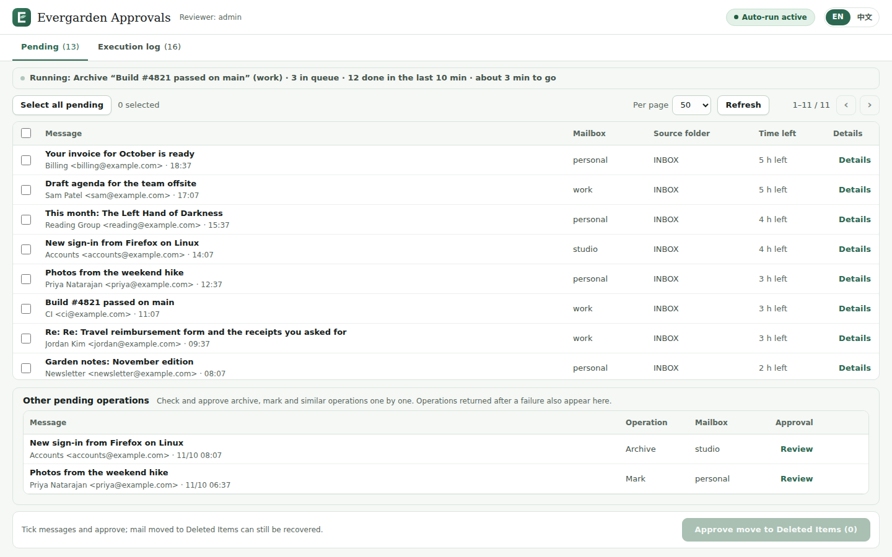
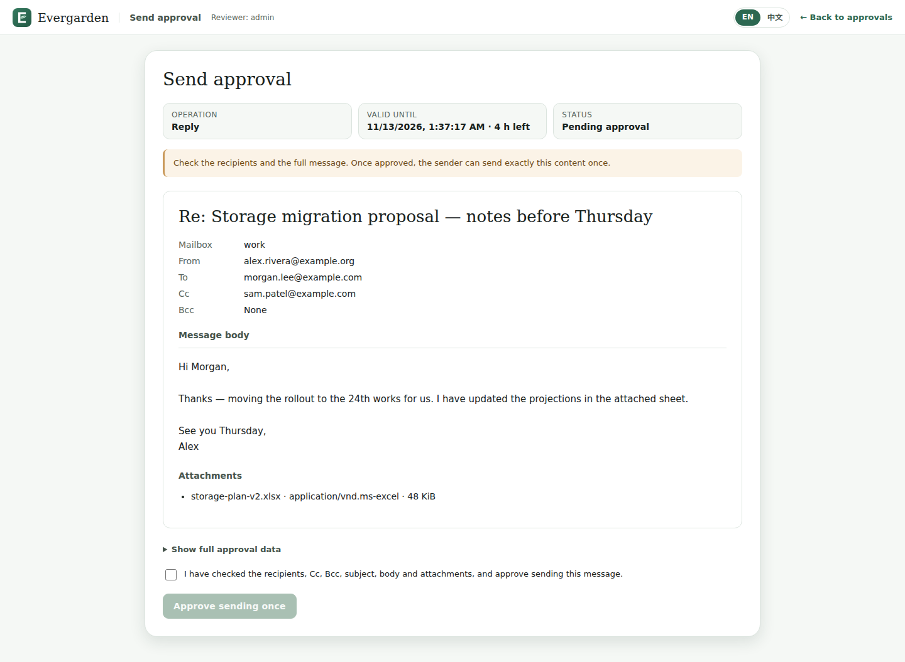
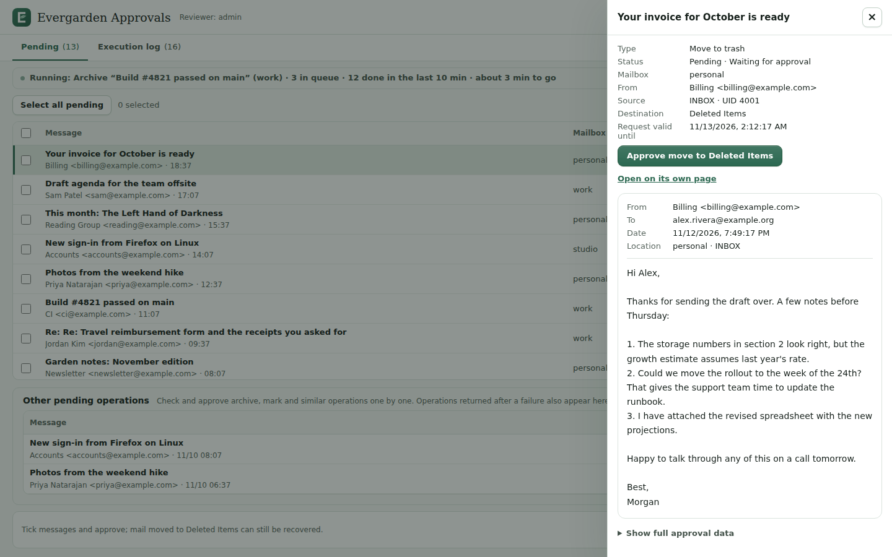
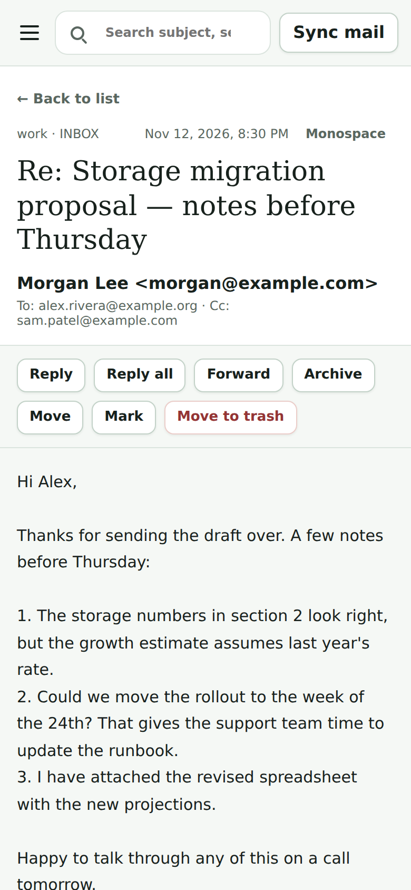
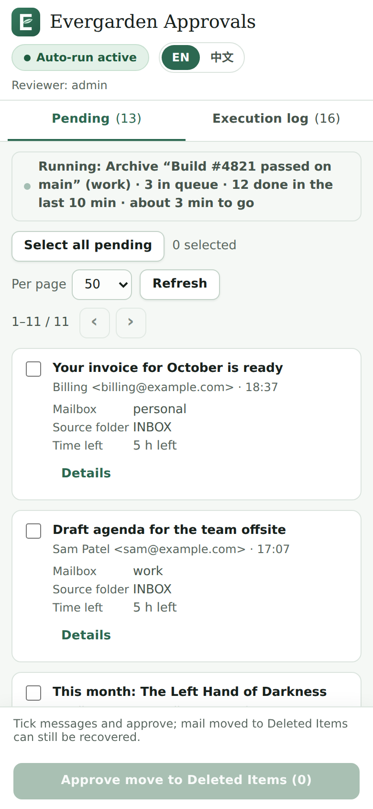
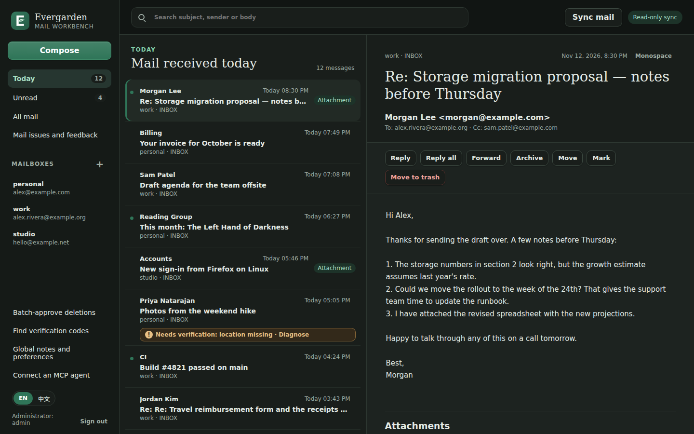

# 使用手册

Evergarden 有两个网页界面，位于同一地址、共用一次登录：

- **邮件工作台**（`/`）：读信、搜索、准备修改；
- **审批页**（`/review`）：批准或撤销修改，查看执行结果。

下文引用的是简体中文界面的文字。英文版见 [user-guide.md](../user-guide.md)。截图为英文界面。

## 登录与语言

使用 setup 创建的管理员账户登录。登录默认保持 7 天（`EVERGARDEN_ADMIN_SESSION_TTL_SECONDS`，
最长 30 天）。侧边栏底部有“退出”。退出会让**所有**浏览器和设备上的登录同时失效，而不只是
当前浏览器：服务器会记录这次退出，并拒绝此前签发的所有会话。

同一地址在 15 分钟内登录失败 15 次（默认值）后，该地址的后续尝试会被暂时拒绝，直到时间窗口
过去。如果多个登录请求同时到达，其中一个可能会被要求一秒后重试。

登录页、工作台侧边栏底部和审批页顶部都有 **EN / 中文** 切换。选择保存在浏览器中；
没有选择时按浏览器语言决定。

## 邮件工作台

- “今日邮件”“未读”“全部邮件”列出所有邮箱的归档邮件；点“邮箱”下的邮箱名只看该邮箱。
- 搜索框在归档中搜索主题、发件人和正文。
- “同步邮件”立即执行一次只读同步，不会改变服务商上的已读状态。每小时的定时同步在后台
  做同样的事。
- 点一封邮件，在右侧打开。正文始终以纯文本显示，从不加载 HTML 和远程图片。“等宽字体”
  切换字体。附件有“下载”按钮，Evergarden 不会替你打开附件。
- 标有“待核实”的邮件在最近一次服务商快照中没有确认的位置，见[邮件异常与反馈](#邮件异常与反馈)。

## 准备修改

对邮箱的每次修改都会先成为一张审批单。打开邮件后的按钮有“回复”“回复全部”“转发”
“归档”“移动”“标记”“移入废纸篓”；侧边栏的“写邮件”用于写新邮件。

1. **写邮件 / 回复 / 转发**：选择“发件邮箱”（以及可见的发件地址），填写收件人、主题和
   正文，添加附件（每个最多 5 MiB），点“生成审批单”。不会直接发送。
2. “归档”移动到该邮箱的归档文件夹。“移动”只提供该邮箱允许的目的文件夹。“标记”提供
   “标为已读”“标为未读”“加旗标”“取消旗标”。“移入废纸篓”需要确认，然后准备一次移到
   配置的废纸篓文件夹的操作；永远不会永久删除。
3. “检查不可变操作”对话框显示确切的请求。点“打开独立审批页”在新标签页中批准。

批准后的执行方式取决于服务器设置：

- 开启后台执行（`EVERGARDEN_APPROVAL_DISPATCH_ENABLED=true`）时，服务器会自动执行已批准
  的请求，点“检查审批状态”查看结果。
- 否则回到对话框，点“检查审批状态”，再点“执行已批准操作”。

agent 准备的请求同样出现在审批页。

## 审批页

页头显示审批人和后台执行状态：“自动执行运行中”“自动执行未运行”，或在未开启后台执行时
显示“客户端执行”。标签下方的活动条显示正在执行的操作、队列长度和预计剩余时间。

### 待审批

“待审批”标签列出等待你处理的请求。

- 主表格列出待批准的“移入废纸篓”请求，包括邮件、邮箱、来源文件夹和“剩余有效期”。
- “其他待审批操作”列出归档、移动、标记和发送。点“去审批”打开。
- “详情”打开侧栏，显示邮件全文，“查看完整审批数据”显示确切的请求。归档、移动和标记
  可以直接在侧栏批准（“批准归档”“批准标记”……）。

审批单在审核期内可以批准（默认 6 小时，`EVERGARDEN_APPROVAL_DRAFT_LIFETIME_HOURS`）。
过期后需要 agent 或你重新准备。批准本身不会过期：一旦批准，请求会执行，或一直等待直到
你撤销。

### 批量审批删除

在工作台侧边栏打开“批量审批删除”，或进入“待审批”标签。逐个勾选邮件，用表头的复选框
（“全选当前页”），或用“选择全部待审批”选中所有页的待删除邮件。然后点
“批准移入已删除邮件（n）”。每个选中的请求都会得到一份绑定自身内容的批准；期间已过期
或已在别处批准的请求会单独报告，其余照常通过。选择较多时会分批提交，按钮上显示进度。
移入废纸篓的邮件仍可从废纸篓文件夹恢复。

### 批准发送

外发邮件有单独的页面（`/review/send`），显示邮箱、发件人、收件人、抄送、密送、主题、
实际发送的正文和附件。勾选“我已核对收件人、抄送、密送、主题、正文及附件，确认批准发送
这封邮件。”，再点“批准发送一次”。批准只针对这份内容，只能发送一次。

### 执行记录

“执行记录”标签列出每个请求的类型、批准方式（“人工”或“自动”）、状态和时间，每 5 秒
刷新一次。筛选项为“全部”“待审批”“执行中”“成功”“失败”：

| 阶段 | 包括 |
|---|---|
| 待审批 | 等待你批准。 |
| 执行中 | 已批准排队中；等待同一邮件的上一操作结束；邮箱暂不可用，稍后自动重试；正在执行；正在核对执行结果；自动批准，等待客户端执行。 |
| 成功 | 服务商确认，或只读核对确认已完成。 |
| 失败 | 服务商拒绝；邮件已不在原文件夹；核对确认未生效；24 小时内无法确认结果；批准已撤销；自动批准后客户端未执行。 |

状态下方的小字说明原因。失败是最终结果；如需重试，请重新准备请求。“正在核对执行结果”
表示命令发出后连接中断：Evergarden 以只读方式核对邮箱，不会重复发送，你无需操作。完整
规则见 [architecture.md](../architecture.md#approval-lifecycle)（英文）。

### 撤销批准

尚未开始执行的批准（排队中、等待重试、等待同一邮件的上一操作）可以撤销：在执行记录中
点该行的“撤销”，或在单独审批页点“撤销批准”，然后确认。服务器将不再执行它。已经开始
执行或已结束的项目不能撤销。

## 邮件异常与反馈

“邮件异常与反馈”列出在最近一次服务商快照中无法确认位置的邮件及原因（例如“位置缺失”
“UIDVALIDITY 变化”）。位置缺失不代表邮件已被归档或删除。“查看 / 提交反馈”显示只读
诊断信息，并可记录你的决定。记录决定不会修改邮件；邮件恢复可操作后，请重新准备请求。

## 其他工具

- **查找验证码**：在最近 10 到 60 分钟的邮件中，查找明确与登录或验证相关的 4–8 位数字。
  可按邮箱和发件域名筛选。由你复制验证码；Evergarden 从不代填，也不打开链接。
- **全局说明与偏好**：给 agent 的邮件处理说明，以及每个邮箱的描述和偏好。在本机加密
  保存，只作参考，不能越过权限或审批。不要在其中写入密码或密钥。
- **MCP 接入指南**：创建和吊销 API key，复制客户端配置片段。见 [mcp.md](../mcp.md)（英文）。
- **管理邮箱**（“邮箱”旁的 **+**）：添加、停用或重新启用邮箱，打开邮箱的 OAuth 连接页。
  见 [providers.md](../providers.md)（英文）。
- **公司邮件通知** 只在配置了可选的
  [Thunderbird 桥接](../advanced/thunderbird-bridge.md)（英文）时出现。

## 手机和小屏幕

两个界面都会适配窄屏：侧边栏变为菜单（“打开菜单”），邮件全屏打开并有“← 返回列表”，
审批表格变为卡片。

| 工作台 | 审批 |
|---|---|
|  |  |

界面也会跟随系统的深色模式。

